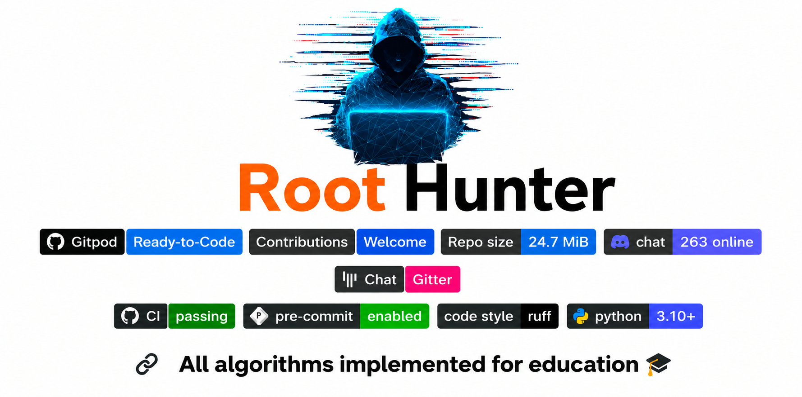

<p align="center">
  
</p>

<div align="center">
  <h1>Root-Hunter1</h1>
  <p>
    <strong>Educational programming repository for algorithms, networking, experimentation, and practical learning.</strong>
  </p>
</div>

A learning-focused repository containing multiple programming experiments, mini-projects, networking examples, algorithmic exercises, and system-level coding explorations.

This repository is not a single production application. Instead, it is a collection of independent code samples created to explore different concepts and technologies in a practical way.

## Overview

This repository brings together:

- Python programming experiments
- data structure and algorithm practice
- networking and UDP communication examples
- asynchronous programming with `asyncio`
- multi-threading and high-throughput sender examples
- Go learning examples
- low-level and system-oriented programming exploration
- educational code designed to improve understanding through practice

## Mission

The main goal of this repository is to help learners build confidence through hands-on coding and experimentation.

It is designed for:

- understanding core programming concepts
- practicing algorithmic thinking
- learning how networking systems work
- exploring concurrency and async behavior
- improving problem-solving skills
- studying real-world code structures in a readable format

## Why This Repository Exists

This project exists as a personal learning archive where ideas are tested, improved, and documented.

It focuses on:

- problem-solving
- structured thinking
- practical coding
- experimentation
- performance awareness
- understanding how systems behave under real conditions

## Repository Highlights

- Educational and beginner-friendly code
- Multiple project folders with different learning goals
- Networking and server/client experimentation
- Concurrency and throughput-focused examples
- Algorithms and data structure practice
- Go and Python learning examples
- Low-level and system interaction concepts

## Project Structure

```text
Root-Hunter1/
├── Ai python/
├── basic-python-projects/
├── Enterprise_UDP_Server/
├── Go Golang/
├── Orginal Python File/
├── Pythone File/
├── recvmmsg ctypes/
├── udp server/
├── Asyncio High Speed Sender Engine
├── Multi-Threaded Request Sender Engine
├── Multiple Thread Max Engine
├── Python Package using Conda
├── README.md
├── LICENSE
├── SECURITY.md
├── 2046199c-b6ad-4dd3-83be-a11ee4a96a48.png
├── algorithms/
│   ├── sorting/
│   │   ├── bubble_sort.py
│   │   ├── insertion_sort.py
│   │   └── quick_sort.py
│   ├── searching/
│   │   ├── binary_search.py
│   │   └── linear_search.py
│   └── graph/
│       ├── bfs.py
│       └── dfs.py
├── data_structures/
│   ├── stack.py
│   ├── queue.py
│   └── linked_list.py
├── examples/
│   └── sample_usage.py
├── tests/
│   └── test_algorithms.py
└── ...
```

## What You Will Find Here

### Algorithms and Data Structures
This section focuses on common algorithmic ideas and core data structure implementations used in software education.

### Python Practice
A major portion of this repository is centered around Python learning, experimentation, and problem-solving.

### Networking and Server Examples
Several folders are dedicated to message delivery, UDP communication, async server/client behavior, and network experimentation.

### Performance and Concurrency
Some examples demonstrate multi-threading and high-throughput request handling to help understand concurrency and efficiency.

### Learning Experiments
This repository also contains exploratory projects for testing code ideas, learning through building, and understanding how systems behave in practice.

## Tech Stack

- Python
- C
- Go
- Asyncio
- UDP/TCP networking
- `ctypes`
- Git and GitHub
- Conda environment management

## Getting Started

### Clone the repository

```bash
git clone https://github.com/Root-Hunter1/Root-Hunter1.git
cd Root-Hunter1
```

### Create a virtual environment (optional)

```bash
python3 -m venv venv
source venv/bin/activate
```

On Windows:

```bash
venv\Scripts\activate
```

### Install dependencies

```bash
pip install -r requirements.txt
```

### Run an example

```bash
python examples/sample_usage.py
```

## Example Usage

```python
from algorithms.sorting.quick_sort import quick_sort

arr = [5, 2, 9, 1, 7]
sorted_arr = quick_sort(arr)
print(sorted_arr)
```

## Learning Goals

This repository is intended to help learners:

- improve Python fundamentals
- practice algorithmic thinking
- study networking fundamentals
- understand `asyncio` and asynchronous execution
- learn concurrency and throughput concepts
- explore low-level and system-oriented coding ideas
- build confidence through experimentation and iteration

## Contributing

Contributions are welcome when they add educational value or improve the clarity of the project.

Please keep contributions:

- readable and well-documented
- focused on learning and experimentation
- easy for others to understand
- structured and maintainable

## Testing

If the project uses pytest, you can run:

```bash
pytest
```

## Security

For security issues or vulnerability reports, please refer to `SECURITY.md`.

## License

This project includes a license file. Please review `LICENSE` for usage terms and conditions.

## Maintainer

- GitHub: @Root-Hunter1
- Repository: https://github.com/Root-Hunter1/Root-Hunter1
- Email: roothunter.code@gmail.com

# This real fully scripts Reprojity:

- GitHub: https://github.com/Root-Hunter1/iot-sensor-dashboard

## Profile Summary

- Name: Root Hunter
- Role: Developer / Algorithm Enthusiast
- Interests: Algorithms, Data Structures, Programming, Problem Solving
- GitHub: https://github.com/Root-Hunter1

## Final Note

This repository is a practical learning space where code is used to explore ideas, improve understanding, and build skill through experimentation.

It reflects a strong focus on:

- learning
- problem-solving
- networking
- systems understanding
- programming fundamentals
- exploration and continuous improvement

---

Created for educational purposes by Root-Hunter1.
